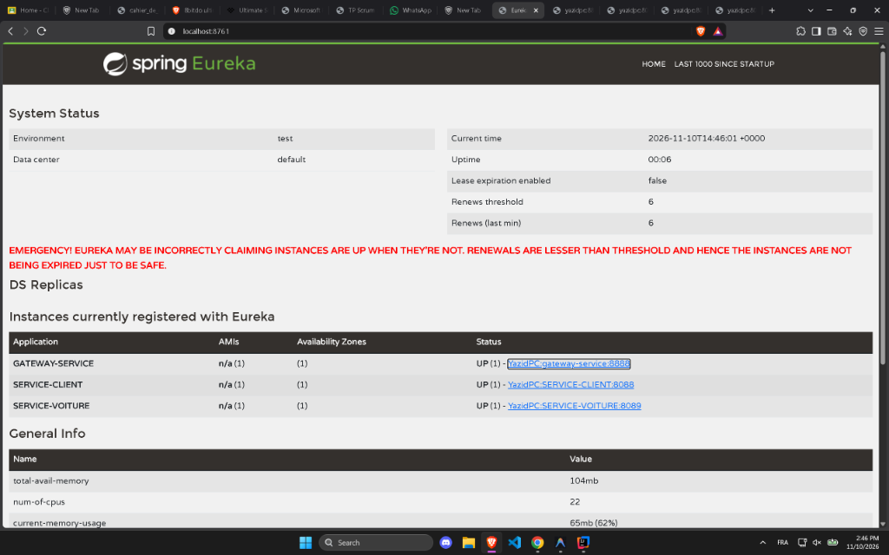
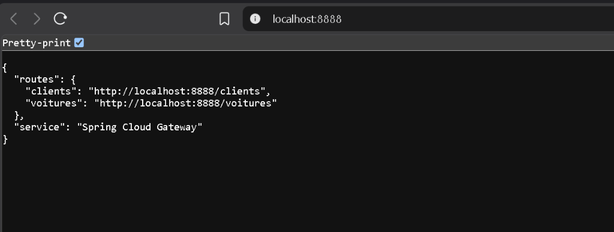
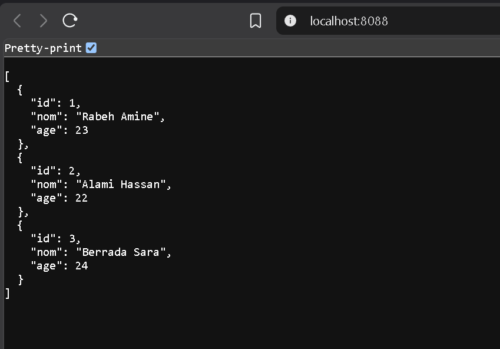
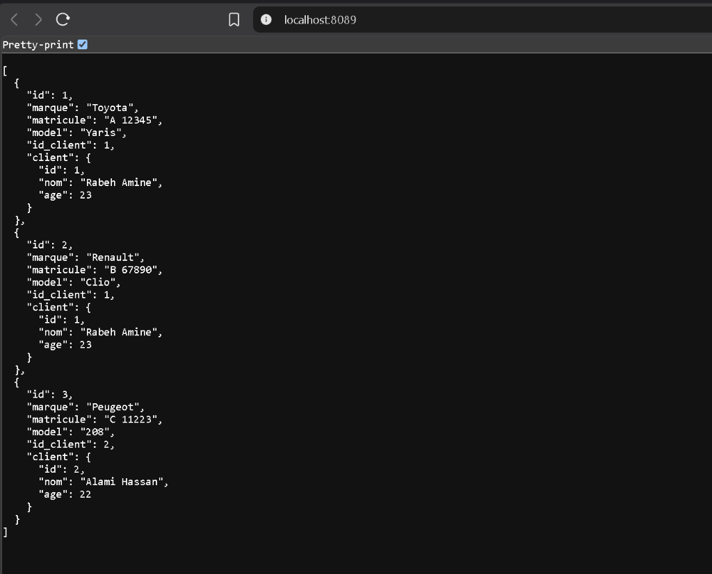

# Rapport de TP — Architecture Microservices avec Spring Cloud

**Module** : Architecture J2EE & Systèmes Distribués  
**École** : EMSI  
**Technologies** : Java 17+, Spring Boot 3.3.4, Spring Cloud 2023.0.3, Netflix Eureka, OpenFeign, Spring Cloud Gateway, Base H2 In-Memory.

---

## Table des Matières
1. [Contexte et Objectifs du TP](#1-contexte-et-objectifs-du-tp)
2. [Architecture et Topologie](#2-architecture-et-topologie)
3. [Détail des Microservices Développés](#3-détail-des-microservices-développés)
4. [Déroulement des Étapes (0 à 10)](#4-déroulement-des-étapes-0-à-10)
5. [Résultats et Captures d'Exécution](#5-résultats-et-captures-dexécution)
6. [Scripts Utilitaires et Tests Automatisés](#6-scripts-utilitaires-et-tests-automatisés)
7. [Ateliers Pratiques Avancés](#7-ateliers-pratiques-avancés)
8. [Configuration Git et Bonnes Pratiques](#8-configuration-git-et-bonnes-pratiques)
9. [Fiche Mémo & Questions Clés pour la Soutenance](#9-fiche-mémo--questions-clés-pour-la-soutenance)

---

## 1. Contexte et Objectifs du TP

Dans une architecture monolithique classique, tous les modules (gestion des clients, des véhicules, passerelle, etc.) partagent la même base de données et la même JVM. Tout changement ou défaillance impacte l'ensemble du système.

Ce TP a pour objectif de transformer cette approche en une **architecture microservices distribuée** en s'appuyant sur l'écosystème **Spring Cloud** :
- **Autonomie des services** : chaque microservice gère son domaine fonctionnel avec son propre stockage indépendant (base H2 en mémoire).
- **Service Discovery (Eureka)** : suppression des adresses IP et ports codés en dur grâce à un registre d'annuaire dynamique.
- **Communication Inter-services Déclarative (OpenFeign)** : appel synchrone HTTP type REST sans manipulation manuelle de `RestTemplate` ni d'URLs fixes.
- **Passerelle d'API Unifiée (Spring Cloud Gateway)** : point d'entrée unique qui masque la topologie interne, assure le routage dynamique (`lb://...`) et la répartition de charge (*Load Balancing*).

---

## 2. Architecture et Topologie

```
                            [ Client (Navigateur / Postman) ]
                                           │
                                           │ Requête HTTP
                                           ▼
                                [ Spring Cloud Gateway ]
                                      Port: 8888
                                     /          \
                       lb://SERVICE-CLIENT    lb://SERVICE-VOITURE
                                   /              \
                                  ▼                ▼
                        [ SERVICE-CLIENT ] ◄───── [ SERVICE-VOITURE ]
                            Port: 8088      OpenFeign   Port: 8089
                        [Base H2: clientdb]        [Base H2: voituredb]
                                 ▲                         ▲
                                 │      s'enregistrent     │
                                 └──────────────┬──────────┘
                                                │
                                       [ Eureka Server ]
                                          Port: 8761
```

### Matrice des Composants et Ports

| Composant | Artifact ID | Port | Base de Données | Rôle Principal |
| :--- | :--- | :---: | :--- | :--- |
| **Eureka Server** | `eureka-server` | `8761` | — | Registre d'annuaire dynamique (Service Discovery) |
| **SERVICE-CLIENT** | `service-client` | `8088` | H2 (`jdbc:h2:mem:clientdb`) | Gestion des entités `Client` (CRUD REST) |
| **SERVICE-VOITURE** | `service-voiture` | `8089` | H2 (`jdbc:h2:mem:voituredb`) | Gestion des `Voiture` + agrégation du `Client` via Feign |
| **Gateway** | `gateway-service` | `8888` | — | Reverse Proxy, routage dynamique et Load Balancer |

---

## 3. Détail des Microservices Développés

### A. Serveur Eureka (`eureka-server` : 8761)
- **Dépendance** : `spring-cloud-starter-netflix-eureka-server`
- **Activation** : Annotation `@EnableEurekaServer`
- **Configuration** :
  ```yaml
  server:
    port: 8761
  spring:
    application:
      name: eureka-server
  eureka:
    instance:
      hostname: localhost
    client:
      register-with-eureka: false  # Ne s'enregistre pas lui-même
      fetch-registry: false        # N'a pas besoin de récupérer son registre
    server:
      enable-self-preservation: false
  ```

---

### B. Microservice Client (`service-client` : 8088)
- **Dépendances** : Spring Web, Spring Data JPA, H2 Database, Eureka Client
- **Entité JPA** :
  ```java
  @Entity
  public class Client {
      @Id
      @GeneratedValue(strategy = GenerationType.IDENTITY)
      private Long id;
      private String nom;
      private Float age;
      // constructeurs, getters et setters
  }
  ```
- **Contrôleur REST** :
  - `GET /clients` : retourne la liste complète des clients.
  - `GET /clients/{id}` : retourne le client correspondant à l'ID.
- **Données initiales** : 3 clients insérés via `CommandLineRunner` :
  1. `Rabeh Amine` (23 ans)
  2. `Alami Hassan` (22 ans)
  3. `Berrada Sara` (24 ans)

---

### C. Microservice Voiture (`service-voiture` : 8089)
- **Dépendances** : Spring Web, Spring Data JPA, H2, Eureka Client, OpenFeign, Resilience4j Circuit Breaker.
- **Entité JPA & Modèle** :
  ```java
  @Entity
  public class Voiture {
      @Id
      @GeneratedValue(strategy = GenerationType.IDENTITY)
      private Long id;
      private String marque;
      private String matricule;
      private String model;
      private Long id_client;

      @Transient
      private Client client; // Enrichi dynamiquement par OpenFeign
  }
  ```
- **Interface Client OpenFeign** :
  ```java
  @FeignClient(name = "SERVICE-CLIENT", fallback = ClientServiceFallback.class)
  public interface ClientService {
      @GetMapping("/clients/{id}")
      Client clientById(@PathVariable("id") Long id);

      @GetMapping("/clients")
      List<Client> allClients();
  }
  ```
- **Contrôleur REST** :
  - `GET /voitures` : récupère toutes les voitures, et pour chaque voiture, contacte automatiquement `SERVICE-CLIENT` pour injecter l'objet `Client` propriétaire.

---

### D. Spring Cloud Gateway (`gateway-service` : 8888)
- **Dépendances** : `spring-cloud-starter-gateway`, `spring-cloud-starter-netflix-eureka-client`, `spring-cloud-starter-loadbalancer`.
- **Routage dynamique** :
  ```yaml
  server:
    port: 8888
  spring:
    application:
      name: gateway-service
    cloud:
      gateway:
        discovery:
          locator:
            enabled: true
            lower-case-service-id: true
        routes:
          - id: r-clients
            uri: lb://SERVICE-CLIENT
            predicates:
              - Path=/clients/**
          - id: r-voitures
            uri: lb://SERVICE-VOITURE
            predicates:
              - Path=/voitures/**
  ```

---

## 4. Déroulement des Étapes (0 à 10)

1. **Étape 0 — Contexte et Architecture** : Formalisation des concepts (autonomie, découverte, routage, LoadBalancer).
2. **Étape 1 — Avantages et Caractéristiques** : Découplage fort, scalabilité horizontale sans SPOF (*Single Point of Failure*).
3. **Étape 2 — Prérequis et Outils** : Mise en place du JDK et de Maven sous IntelliJ IDEA.
4. **Étape 3 — Création du Eureka Server** : Configuration du port `8761` et annotation `@EnableEurekaServer`.
5. **Étape 4 — Création du Microservice Client** : Entité `Client`, `ClientRepository`, `ClientController`, initialisation H2.
6. **Étape 5 — Création de la Gateway (Routage statique)** : Configuration initiale de routes HTTP fixes.
7. **Étape 6 — Gateway avec Eureka (Routage dynamique)** : Utilisation du préfixe `lb://SERVICE-CLIENT` avec `Spring Cloud LoadBalancer`.
8. **Étape 7 — Création du Microservice Voiture** : Entité `Voiture`, association de `id_client`, et mise en place du client Feign `@FeignClient`.
9. **Étape 8 — Contrôleur Voiture** : Implémentation du contrôleur qui interroge Feign pour peupler le champ `@Transient Client`.
10. **Étape 9 — Gateway vers SERVICE-VOITURE** : Ajout de la route `lb://SERVICE-VOITURE` sur la Gateway.
11. **Étape 10 — Vérifications finales** : Tests de bout en bout de l'enregistrement Eureka et des réponses JSON.

---

## 5. Résultats et Captures d'Exécution

### A. Tableau de bord Eureka Server (`http://localhost:8761`)
Le serveur Eureka affiche bien les 3 instances enregistrées et actives avec le statut **UP (1)** :
- `GATEWAY-SERVICE:8888`
- `SERVICE-CLIENT:8088`
- `SERVICE-VOITURE:8089`



---

### B. Point d'Entrée Spring Cloud Gateway (`http://localhost:8888`)
La Gateway expose ses routes publiques centralisées vers les microservices métier :



```json
{
  "routes": {
    "clients": "http://localhost:8888/clients",
    "voitures": "http://localhost:8888/voitures"
  },
  "service": "Spring Cloud Gateway"
}
```

---

### C. Microservice Client (`http://localhost:8088` ou `http://localhost:8888/clients`)
Récupération de la liste des clients enregistrés en base H2 :



```json
[
  { "id": 1, "nom": "Rabeh Amine", "age": 23 },
  { "id": 2, "nom": "Alami Hassan", "age": 22 },
  { "id": 3, "nom": "Berrada Sara", "age": 24 }
]
```

---

### D. Microservice Voiture avec OpenFeign (`http://localhost:8089` ou `http://localhost:8888/voitures`)
L'appel à `SERVICE-VOITURE` enrichit chaque voiture avec les données complètes de son propriétaire `client` via l'interface Feign en interrogeant dynamiquement `SERVICE-CLIENT` :



```json
[
  {
    "id": 1,
    "marque": "Toyota",
    "matricule": "A 12345",
    "model": "Yaris",
    "id_client": 1,
    "client": {
      "id": 1,
      "nom": "Rabeh Amine",
      "age": 23
    }
  },
  {
    "id": 2,
    "marque": "Renault",
    "matricule": "B 67890",
    "model": "Clio",
    "id_client": 1,
    "client": {
      "id": 1,
      "nom": "Rabeh Amine",
      "age": 23
    }
  },
  {
    "id": 3,
    "marque": "Peugeot",
    "matricule": "C 11223",
    "model": "208",
    "id_client": 2,
    "client": {
      "id": 2,
      "nom": "Alami Hassan",
      "age": 22
    }
  }
]
```

---

## 6. Scripts Utilitaires et Tests Automatisés

Le projet inclut des scripts à la racine pour automatiser le cycle de vie des microservices :

| Fichier | Description | Commande / Utilisation |
| :--- | :--- | :--- |
| [`start-services.bat`](start-services.bat) | Démarre automatiquement les 4 services dans le bon ordre avec leurs logs séparés. | Double-clic |
| [`stop-services.bat`](stop-services.bat) | Libère instantanément les 4 ports (`8761`, `8088`, `8089`, `8888`). | Double-clic |
| [`test-endpoints.ps1`](test-endpoints.ps1) | Teste automatiquement la réponse HTTP 200 de tous les endpoints. | Voir ci-dessous |

### Exécution du script de test automatisé :
```powershell
powershell -ExecutionPolicy Bypass -File test-endpoints.ps1
```

### Résultat de l'exécution :
```
=================================================
 Verification des Endpoints Microservices Spring 
=================================================
[OK 200] Eureka Dashboard : http://localhost:8761
[OK 200] Service Client (Direct) : http://localhost:8088/clients
[OK 200] Service Voiture (Direct - Feign) : http://localhost:8089/voitures
[OK 200] Gateway (Accueil) : http://localhost:8888/
[OK 200] Gateway -> Clients (lb://) : http://localhost:8888/clients
[OK 200] Gateway -> Voitures (lb://) : http://localhost:8888/voitures
=================================================
```

---

## 7. Ateliers Pratiques Avancés

### Atelier 1 — Démonstration du Load Balancing (Round-Robin)

Pour prouver la scalabilité horizontale, on peut démarrer une **deuxième instance** de `SERVICE-CLIENT` sur le port `8087` :

```powershell
$env:JAVA_HOME = "C:\Program Files\JetBrains\IntelliJ IDEA 2026.2.4\jbr"
& "$env:JAVA_HOME\bin\java.exe" -jar service-client\target\service-client-0.0.1-SNAPSHOT.jar --server.port=8087
```

**Constat sur Eureka ([http://localhost:8761](http://localhost:8761))** :
`SERVICE-CLIENT` affiche : `UP (2) - YazidPC:SERVICE-CLIENT:8088 , YazidPC:SERVICE-CLIENT:8087`.  
Les requêtes vers `http://localhost:8888/clients` sont réparties alternativement entre les deux instances par `Spring Cloud LoadBalancer`.

---

### Atelier 2 — Tolérance aux Pannes & Résilience (Circuit Breaker)

Si `SERVICE-CLIENT` s'arrête ou subit une panne :
1. Dans IntelliJ, arrêtez `ServiceClientApplication`.
2. Appelez `http://localhost:8888/voitures`.
3. Grâce à la classe [`ClientServiceFallback.java`](service-voiture/src/main/java/com/example/servicevoiture/services/ClientServiceFallback.java), le service voiture renvoie toujours un code HTTP `200 OK` avec des informations de repli en mode dégradé, évitant ainsi l'effet domino d'erreur 500 sur l'ensemble de l'infrastructure.

---

## 8. Configuration Git et Bonnes Pratiques

Un fichier [`.gitignore`](.gitignore) complet a été placé à la racine pour exclure les binaires compilés et les caches d'IDE :

```gitignore
target/
!.mvn/wrapper/maven-wrapper.jar
!**/src/main/**/target/
!**/src/test/**/target/

### STS ###
.apt_generated
.classpath
.factorypath
.project
.settings
.springBeans
.sts4-cache

### IntelliJ IDEA ###
.idea/
*.iws
*.iml
*.ipr

### Logs & OS ###
*.log
.DS_Store
Thumbs.db
```

---

## 9. Fiche Mémo & Questions Clés pour la Soutenance

| Question d'examen | Réponse technique attendue |
| :--- | :--- |
| **Pourquoi utiliser Eureka plutôt que des URLs fixes ?** | Évite le couplage fort avec les adresses IP physiques. Permet le scaling dynamique (démarrer/arrêter des instances à la volée) et la découverte automatique par nom logique (`spring.application.name`). |
| **Comment OpenFeign résout-il les adresses ?** | En coulisses, Feign interroge le client Eureka local pour obtenir la liste des instances enregistrées sous le nom `SERVICE-CLIENT`, puis choisit une adresse via le LoadBalancer. |
| **Quel est le rôle de la Gateway ?** | Point d'entrée unique (Reverse Proxy). Elle centralise le routage (`lb://...`), la sécurité, le CORS, le filtrage des requêtes et isole le réseau interne. |
| **Où se fait l'équilibrage de charge ?** | Il est **Client-Side** (côté client appelant : la Gateway ou le client Feign) via `Spring Cloud LoadBalancer` selon l'algorithme Round-Robin. |
| **Pourquoi avoir deux bases de données H2 séparées ?** | Respect du pattern **Database-per-Service** : chaque microservice est le seul propriétaire de ses données, garantissant un découplage total. |
